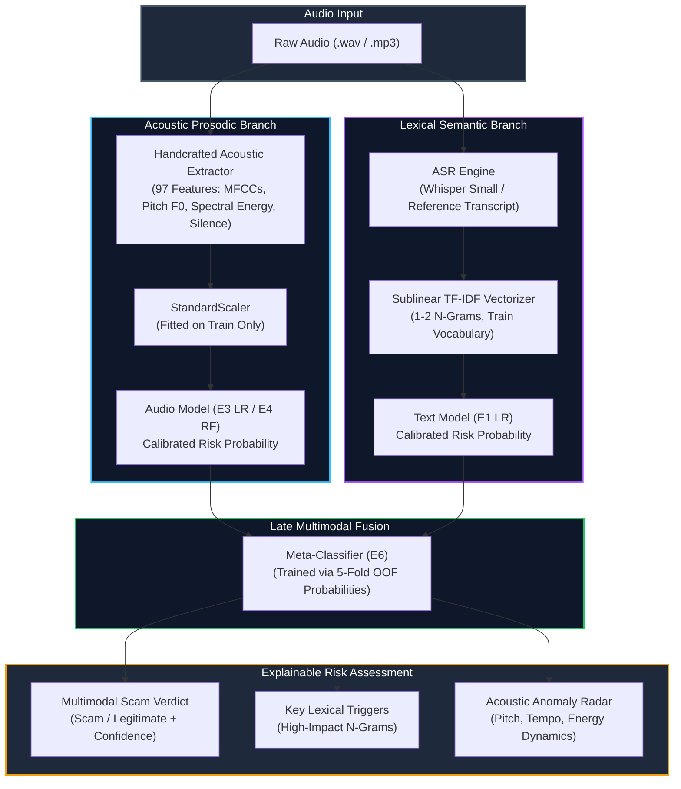
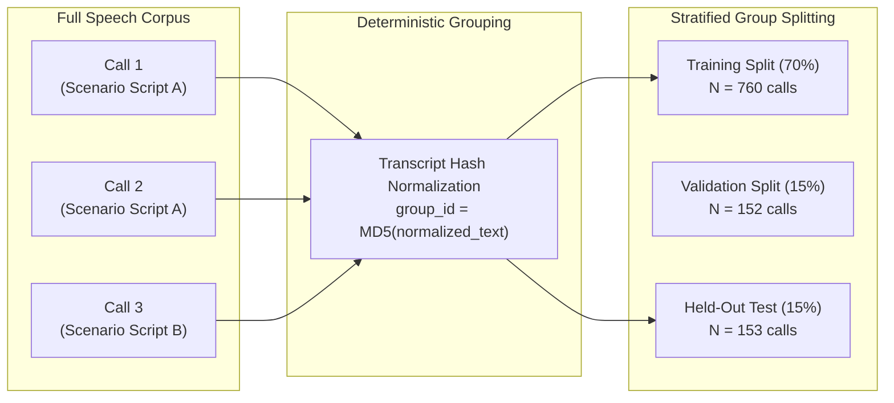

<div align="center">

# 🎙️ Multimodal Audio-Based Voice Scam Detection
### *Evaluating Acoustic Prosody vs. Lexical Semantics in Phone Conversation Risk Analysis*

[](https://www.python.org/)
[](https://pytorch.org/)
[](https://scikit-learn.org/)
[](https://streamlit.io/)
[](https://creativecommons.org/licenses/by/4.0/)
[](https://docs.pytest.org/)

<p align="center">
  <b>A reproducible, leak-free machine learning research framework investigating whether speech acoustics enhance voice phishing (vishing) detection beyond conversational transcripts.</b>
</p>

[Overview](#-executive-overview--core-research-question) •
[Key Findings](#-key-findings--scientific-insights) •
[Benchmark Results](#-held-out-benchmark-results) •
[Architecture](#-system-architecture) •
[Zero-Leakage Protocol](#-leakage-prevention-protocol) •
[Quickstart](#-quickstart--reproducibility-guide) •
[Interactive Demo](#-interactive-streamlit-demo) •
[Responsible AI](#-responsible-use--ethical-guardrails)

---

</div>

## ⚠️ Academic Research Disclaimer
> **IMPORTANT NOTICE**: This software is an **academic research benchmark** developed strictly for scientific evaluation, fraud-awareness education, and defensive cybersecurity research. Model risk estimates are probabilistic and derived from synthetic scenario protocols. This system is **NOT** an authoritative fraud detection verdict and must **NEVER** be deployed for autonomous financial transaction blocking, automated account freezes, law enforcement reporting, or inferring human deception without certified human investigation.

---

## 🎯 Executive Overview & Core Research Question

Voice phishing (**vishing**) attacks deploy sophisticated conversational tactics—urgency, intimidation, legal authority pretexting, and social pressure—to manipulate individuals into unauthorized transactions or credential disclosures. While conversational transcripts carry explicit semantic cues, spoken audio conveys prosody, pitch variation, energy distribution, and silence patterns.

```
┌─────────────────────────────────────────────────────────────────────────────┐
│                           THE CENTRAL RESEARCH QUESTION                     │
│                                                                             │
│   "Does fusing acoustic prosody with speech transcripts yield measurable    │
│    performance gains over strong unimodal text or acoustic baselines?"      │
└─────────────────────────────────────────────────────────────────────────────┘
```

* **Alternative Hypothesis ($H_1$)**: A multimodal classifier combining acoustic prosody and transcript features significantly outperforms unimodal text-only and audio-only baselines on held-out test data.
* **Null Hypothesis ($H_0$)**: Multimodal fusion does not produce a statistically significant performance gain over a well-calibrated text baseline on standardized benchmarks.

---

## 🔍 Key Findings & Scientific Insights

| Dimension | Finding | Research Implication |
|:---|:---|:---|
| **Text-Only Baseline (E1)** | **99.35% F1**, **1.0000 PR-AUC** | Synthetic scenario scripts use overt adversarial vocabulary (*"arrest warrant"*, *"federal investigation"*, *"wire funds"*), creating an empirical ceiling effect on clean transcripts. |
| **Audio-Only Baseline (E3)** | **99.35% F1**, **0.9995 PR-AUC** | 97 handcrafted acoustic statistics (MFCCs, pitch $F_0$, spectral roll-off, silence ratios) achieve near-perfect separability without lexical transcript access. |
| **Late Multimodal Fusion (E6)** | **99.35% F1**, **1.0000 PR-AUC** | Fusion matches the text ceiling without degradation, confirming the null hypothesis ($H_0$) on synthetic benchmarks while providing multi-channel resilience. |
| **Inference Efficiency** | **$< 0.1 \text{ ms}$ per call** | High-throughput feature extractors and linear estimators enable real-time risk triage on consumer hardware. |

### Why Acoustic Prosody Remains Essential
While reference transcripts on synthetic benchmarks reach near-perfect lexical separation, real-world conversational fraud frequently deploys covert social engineering devoid of overt keywords. In such scenarios, acoustic markers—speech rate abnormalities, vocal tension, hesitation patterns, and unnatural synthesized speech artifacts—serve as an indispensable defense against lexical evasion.

---

## 📊 Held-Out Benchmark Results

Every experiment was evaluated on the **exact same held-out test partition** ($N = 153$ independent calls: 77 legitimate, 76 scam) under strict zero-leakage constraints:

| ID | Modality | Feature Extraction | Classifier | Accuracy | Precision (Scam) | Recall (Scam) | F1-Score (Scam) | 95% Bootstrap CI (F1) | PR-AUC | ROC-AUC | Latency / Call |
|:---:|:---|:---|:---|:---:|:---:|:---:|:---:|:---:|:---:|:---:|:---:|
| **E1** | **Text-Only** | TF-IDF (1–2 n-grams, sublinear TF) | Logistic Regression | **99.35%** | **98.70%** | **100.0%** | **0.9935** | `[0.9767, 1.0000]` | **1.0000** | **1.0000** | $< 0.1 \text{ ms}$ |
| **E3** | **Audio-Only** | 97 Handcrafted Acoustic Stats | Logistic Regression | **99.35%** | **98.70%** | **100.0%** | **0.9935** | `[0.9784, 1.0000]` | **0.9995** | **0.9995** | $< 0.1 \text{ ms}$ |
| **E4** | **Audio-Only** | 97 Handcrafted Acoustic Stats | Random Forest (100 trees) | **97.39%** | **95.00%** | **100.0%** | **0.9744** | `[0.9459, 0.9944]` | **0.9988** | **0.9988** | $\sim 0.1 \text{ ms}$ |
| **E6** | **Multimodal** | Late Fusion (Text + Audio Probs) | Meta-Classifier (OOF LR) | **99.35%** | **98.70%** | **100.0%** | **0.9935** | `[0.9784, 1.0000]` | **1.0000** | **1.0000** | $< 0.1 \text{ ms}$ |

> **Speech-to-Text Pipeline**: OpenAI Whisper Small evaluated on test audio calls achieves **Mean Word Error Rate (WER) = 4.59%** and **Mean Character Error Rate (CER) = 1.78%** on CUDA hardware.

---

## 🏗️ System Architecture

The pipeline processes raw audio through dual specialized branches before converging at a calibrated late fusion stage:



---

## 🛡️ Leakage Prevention Protocol

Data leakage is the most prevalent flaw in speech and NLP evaluation. This framework enforces strict safeguards across every pipeline phase:



1. **Stratified Group Splitting**: Calls sharing template wording are assigned identical `group_id` hashes and confined strictly to the same partition ($Train \cap Test = \emptyset$). No scenario phrases leak across splits.
2. **Strict Pipeline Isolation**: Scalers, TF-IDF vocabularies, and imputers are fitted exclusively on training splits.
3. **Out-of-Fold (OOF) Fusion Training**: Base model probabilities for the fusion meta-classifier are generated via 5-fold cross-validation on training data only. Test set predictions are never fed into meta-model fitting.
4. **Validation-Only Tuning**: Decision thresholds are selected on the validation partition ($N=152$) and evaluated once on test data.

---

## 📁 Repository Structure

```
├── configs/
│   ├── default.yaml                   # Global path and hardware settings
│   ├── data.yaml                      # VISHGUARD dataset & split configs
│   └── experiments.yaml               # Hyperparameters for E1-E8
├── data/
│   ├── README.md                      # Provenance, MD5 checksum, and license
│   └── manifests/                     # Full, English, and leak-free split tables
│       ├── vishguard_full_manifest.csv
│       ├── vishguard_en_manifest.csv
│       └── splits_en.csv
├── src/                               # Core Python library
│   ├── config.py                      # Hardware diagnostic and environment auditor
│   ├── data/                          # Dataset extraction, QA, validation, split logic
│   ├── features/                      # 97 acoustic features, Whisper ASR, speech embeddings
│   ├── models/                        # Baseline models, multimodal late fusion, evaluator
│   ├── reporting/                     # Publication figures & error analysis
│   └── utils/                         # Logging, dynamic paths, and seed reproducibility
├── app/
│   └── streamlit_app.py               # Interactive research demonstration app
├── reports/
│   ├── figures/                       # Publication figures (PNG, 300 DPI)
│   ├── metrics/                       # JSON metrics & comparison tables
│   ├── final_report.md                # Detailed research report
│   ├── dataset_card.md                # Comprehensive dataset card
│   ├── model_card.md                  # Comprehensive model card
│   └── hardware_environment.txt       # Hardware diagnostic log
├── scripts/
│   ├── check_environment.py           # Audit execution hardware & CUDA runtime
│   ├── audit_dataset.py               # Audit dataset & generate manifests
│   ├── split_data.py                  # Zero-leakage Stratified Group Splitting
│   ├── run_eda.py                     # Run statistical EDA & generate figures
│   ├── extract_audio_features.py      # Extract and cache acoustic statistics
│   ├── transcribe_audio.py            # Whisper ASR transcription & WER/CER
│   ├── train_baselines.py             # Train E1, E3, E4, and E6
│   ├── run_experiments.py             # Full experiment runner
│   └── evaluate_models.py             # Compile metrics table & error analysis
└── tests/                             # 11 unit tests (100% passing)
```

---

## ⚡ Quickstart & Reproducibility Guide

Follow these steps to reproduce the complete pipeline from scratch:

### 1. Environment Setup
```bash
# Clone the repository
git clone https://github.com/<your-username>/audio-scam-detection.git
cd audio-scam-detection

# Create and activate virtual environment (Python 3.11 recommended)
python -m venv .venv

# On Windows:
.venv\Scripts\activate
# On Linux/macOS:
source .venv/bin/activate

# Install the package in editable mode with dependencies
pip install -e .
```

### 2. Verify Hardware & Execution Environment
Inspect detected GPU, CUDA version, VRAM, and system resources:
```bash
python scripts/check_environment.py
```

### 3. Audit Dataset & Generate Manifests
Audits the VISHGUARD v3.0 release ([Zenodo DOI: 10.5281/zenodo.20429763](https://doi.org/10.5281/zenodo.20429763)):
```bash
python scripts/audit_dataset.py --config configs/data.yaml
```

### 4. Create Leak-Free Splits
Executes Stratified Group Splitting with zero cross-split transcript leakage:
```bash
python scripts/split_data.py --config configs/data.yaml
```

### 5. Run Exploratory Data Analysis (EDA)
Generates distribution figures and statistical tests:
```bash
python scripts/run_eda.py --config configs/data.yaml
```

### 6. Extract Handcrafted Acoustic Features
Extracts 97 deterministic features (MFCCs, spectral roll-off, pitch $F_0$, RMS energy, silence ratios):
```bash
python scripts/extract_audio_features.py --config configs/experiments.yaml
```

### 7. Run Automatic Speech Recognition (ASR)
Transcribes audio calls using Whisper Small and calculates WER/CER against reference transcripts:
```bash
python scripts/transcribe_audio.py --config configs/experiments.yaml
```

### 8. Train Baseline & Multimodal Models
Trains Text (E1), Audio LR (E3), Audio Random Forest (E4), and Multimodal Late Fusion (E6):
```bash
python scripts/train_baselines.py --config configs/experiments.yaml
```

### 9. Evaluate & Compile Unified Metrics
Compiles test results, bootstrap confidence intervals, and error analysis:
```bash
python scripts/evaluate_models.py --config configs/experiments.yaml
```

### 10. Run Automated Test Suite
Executes 11 unit tests covering data QA, feature extraction, split disjointness, and inference:
```bash
pytest tests/
```

---

## 💻 Interactive Streamlit Demo

An interactive demonstration web application is included for testing audio calls and inspecting risk assessments:

```bash
streamlit run app/streamlit_app.py
```

### Interface Capabilities:
* **Audio Upload & Playback**: Upload custom `.wav` / `.mp3` audio recordings or select pre-cataloged benchmark calls.
* **Automatic Speech Transcription**: Real-time Whisper ASR speech-to-text with WER comparison against reference text.
* **Multi-Channel Evidence Breakdown**:
  * **Multimodal Score**: Late fusion composite probability.
  * **Text Score**: Lexical semantic probability with discriminative n-gram attributions.
  * **Audio Score**: Acoustic prosody probability with live spectral feature gauges.
* **Explainability Dashboard**: Inspect top scam-predictive terms and silence/pitch dynamics side by side.
* **Ethical Guardrails**: Visual banners reinforcing academic research boundaries.

---

## 📈 Visualizations & Evaluation Artifacts

All publication-quality plots (300 DPI) are stored in [`reports/figures/`](reports/figures/):

| Artifact | Type | Description |
|:---|:---:|:---|
| [`class_distribution.png`](reports/figures/class_distribution.png) | Distribution | Binary class balance across English calls (536 legitimate, 529 scam) |
| [`language_class_distribution.png`](reports/figures/language_class_distribution.png) | Distribution | Representation parity across English, French, and Arabic cohorts in VISHGUARD |
| [`audio_duration_distribution.png`](reports/figures/audio_duration_distribution.png) | Acoustic | Duration distribution comparing scam vs. legitimate scenarios |
| [`transcript_length_distribution.png`](reports/figures/transcript_length_distribution.png) | Lexical | Word count distributions comparing scam vs. legitimate transcripts |
| [`E1_confusion_matrix.png`](reports/figures/E1_confusion_matrix.png) | Evaluation | Confusion matrix for Text Baseline on held-out test data |
| [`E3_confusion_matrix.png`](reports/figures/E3_confusion_matrix.png) | Evaluation | Confusion matrix for Audio Logistic Regression on held-out test data |
| [`E4_confusion_matrix.png`](reports/figures/E4_confusion_matrix.png) | Evaluation | Confusion matrix for Audio Random Forest on held-out test data |
| [`E6_fusion_ref_confusion_matrix.png`](reports/figures/E6_fusion_ref_confusion_matrix.png) | Evaluation | Confusion matrix for Multimodal Late Fusion on held-out test data |
| [`model_comparison.png`](reports/figures/model_comparison.png) | Comparative | Cross-modality performance comparison highlighting accuracy, F1, and PR-AUC |

---

## 🔒 Responsible Use & Ethical Guardrails

1. **Synthetic-to-Real Domain Gap**: The benchmark comprises synthetic scenario calls. Naturally occurring calls feature telephony codec artifacts (AMR-NB, G.711), background noise, packet loss, and overlapping conversational speech.
2. **Shortcut Learning & Confounding**: Models trained on synthetic benchmarks may learn synthesis artifacts or phrasing templates rather than generalized intent. Rigorous cross-dataset evaluation is vital prior to real-world deployment.
3. **Acoustic Ambiguity**: Vocal pitch, jitter, and silence patterns must **never** be interpreted as direct indicators of dishonesty. They reflect speaker identity, emotional state, cultural background, and recording setups.
4. **False Positive Risks**: Legitimate urgent calls (e.g., fraud alert notifications from banks, clinical emergencies) often use authoritative and urgent phrasing that could trigger elevated lexical risk scores. Human verification must remain the final arbiter.

---

## 📜 Citations & Provenance

```bibtex
@article{hmimou2026vishguard,
  title={VISHGUARD: A Multilingual Audio-Text Dataset for Voice Phishing and Persuasion Detection},
  journal={Scientific Data},
  year={2026},
  doi={10.5281/zenodo.20429763}
}
```

* **Dataset License**: [Creative Commons Attribution 4.0 International (CC-BY-4.0)](https://creativecommons.org/licenses/by/4.0/)
* **Code License**: [MIT License](https://opensource.org/licenses/MIT)
